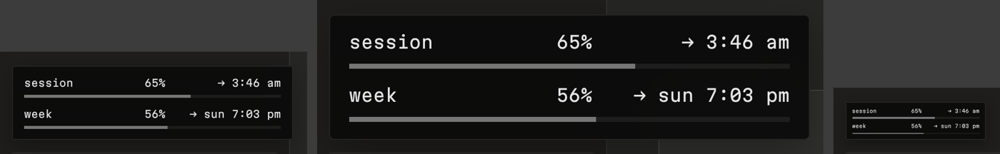

# Epic claude usage tracker

A tiny Chrome extension that keeps your **claude.ai usage limits** — the 5-hour session and the weekly limit, with reset times — always on screen, right inside claude.ai.

- updates by itself: after every Claude reply, when you come back to the tab, and once a minute
- grey bars turn soft yellow from 70% and soft red from 90%
- drag it anywhere, resize it, collapse it into one line — it remembers

## Install (2 minutes)

Works in Chrome, Arc, Brave and Edge.

1. Download **`epic-claude-usage-tracker.zip`** from the [latest release](../../releases/latest) and unzip it.
2. Move the `epic-claude-usage-tracker` folder somewhere permanent (e.g. Documents) — the browser loads the extension from it.
3. Open `chrome://extensions`.
4. Turn on **Developer mode** (top right).
5. Click **Load unpacked** and choose the folder.
6. Reload claude.ai.

## Use

| action | what it does |
|---|---|
| drag | move it (position is remembered) |
| click | refresh now |
| double-click | compact one-line mode |
| drag the top-right corner / pinch on the trackpad | resize, 50–500% |
| double-click the corner | back to default size |

## Privacy

It reads the same usage numbers the claude.ai **Settings → Usage** page shows, using your existing claude.ai session. Nothing is sent anywhere else; no analytics.

The endpoint is undocumented, so if claude.ai changes it the tracker shows `usage: n/a` — open an issue.

## Credits

Made by [Saveliy Sharkov](https://instagram.com/savelliy). Font: [Martian Mono](https://github.com/evilmartians/mono) by Evil Martians, SIL Open Font License 1.1.
